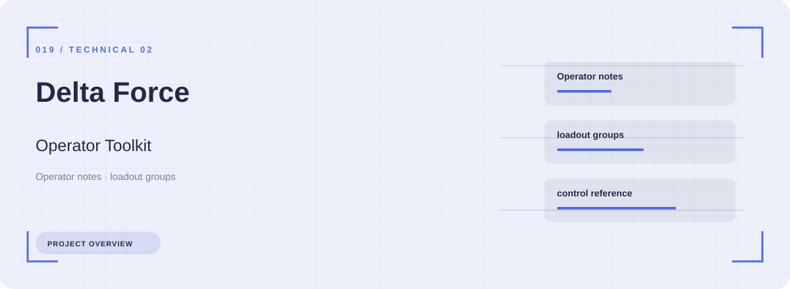
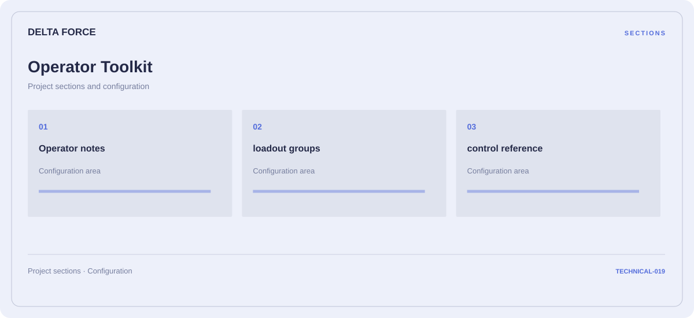

# 🧭 Delta Force Operator Toolkit

**Operator notes · Loadout groups · Control reference**

## ⚡ Features

Operator notes, loadout groups, and control reference form the core of Delta Force Operator Toolkit. Related configuration is grouped by task rather than collected in an undifferentiated list.

### ⚙️ Operator notes

Character or team groups presented with the context needed to organize a session.

### 🧩 Loadout groups

Equipment categories and the associated selection or configuration options.

### ⌨️ Control reference

A dedicated section for control reference and the configuration details associated with that area.

## 🖥️ Project navigation

## 📥 Download

The button and cover open the project's download page. Use the information supplied with the downloaded package for installation and release-specific requirements.

## 📚 Project documentation

- [Feature reference](docs/FEATURES.md)
- [Download information](docs/DOWNLOAD.md)
- [Project page](index.html)

---

Delta Force Operator Toolkit · Program documentation and download information.
                                                                                                    